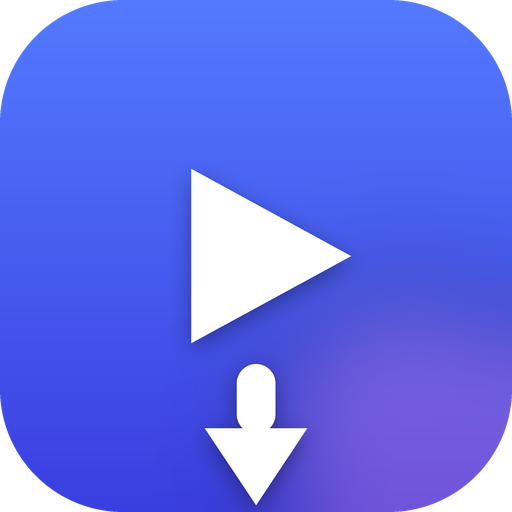
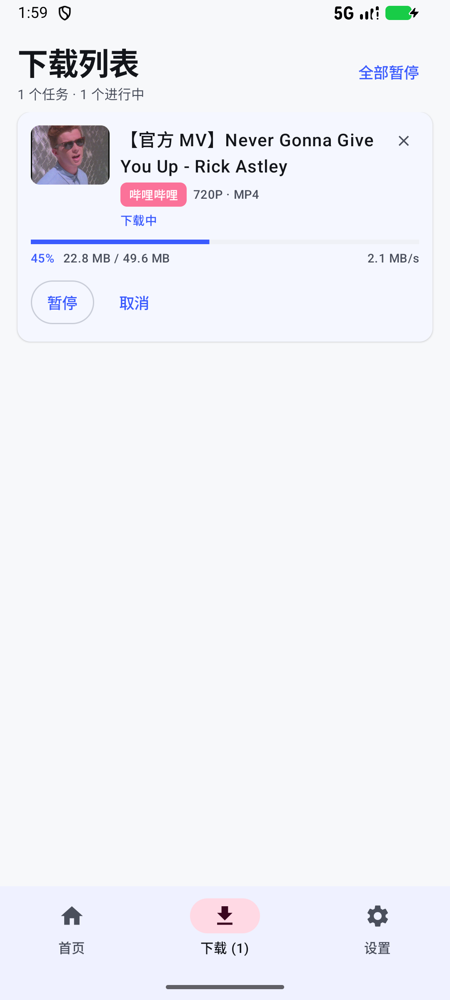
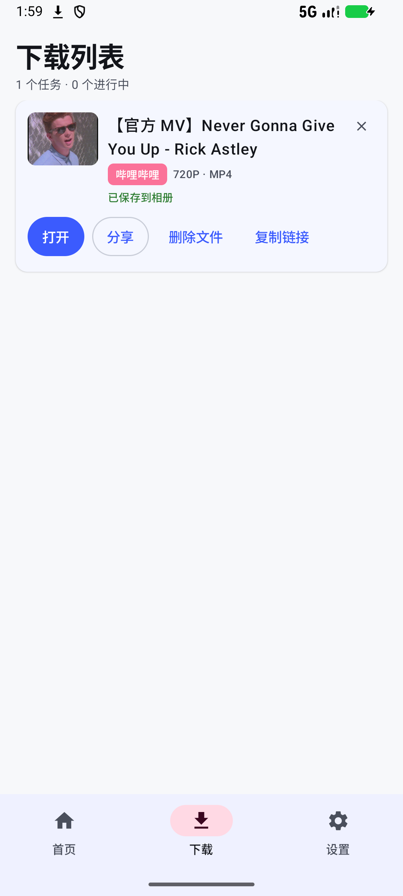
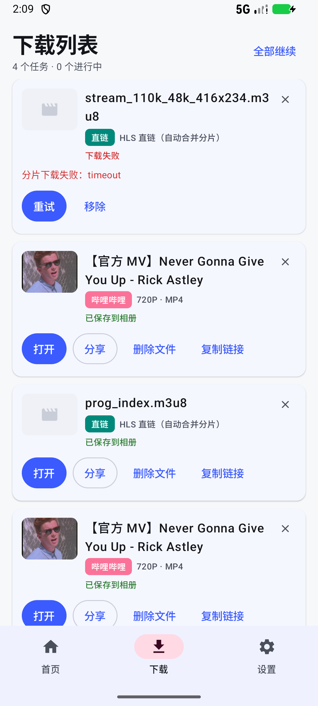
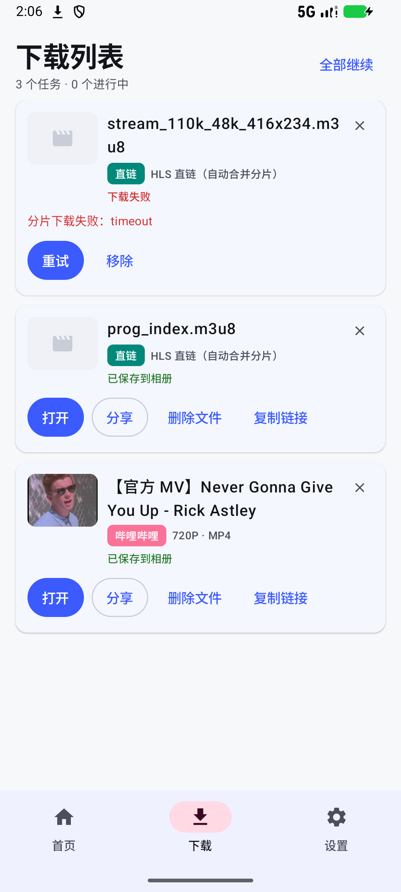
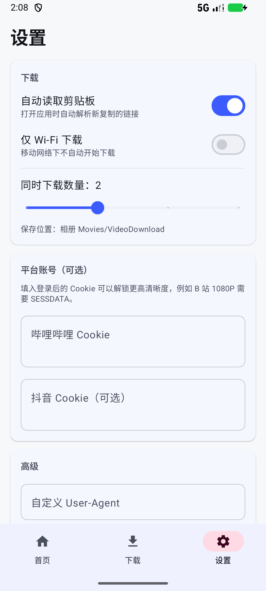
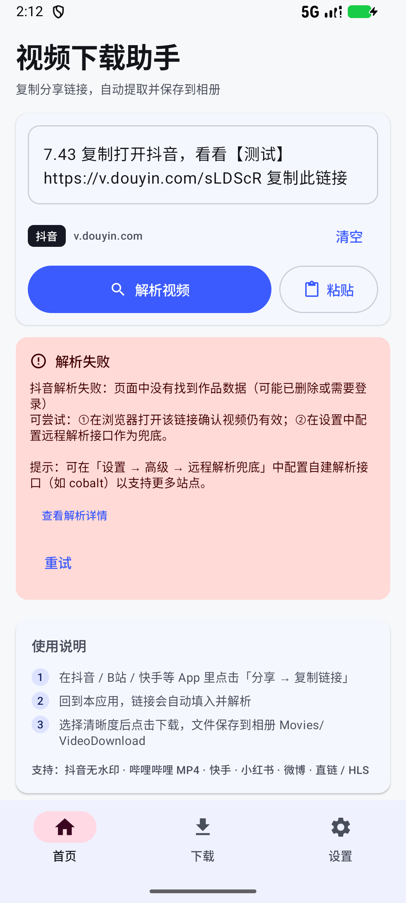

# 视频下载助手（VideoDownload）

一个原生 Android 应用：**复制抖音 / 哔哩哔哩 / 快手 / 小红书 / 微博等平台的分享链接，粘贴进应用即可解析并下载视频到相册**。

- 纯 Kotlin + Jetpack Compose，单 Activity、Material 3
- 无需服务器：解析、下载、保存全部在手机上完成
- 可选「远程解析接口」兜底（自建 cobalt 等），应对平台风控

> **下载安装**：直接安装调试包 → [Releases · v1.0.0 `VideoDownload-1.0.0-debug.apk`](https://github.com/DACINGC/VideoDownload/releases/latest)
> （`minSdk 24` / `targetSdk 34`，debug 签名，仅供测试）



---

## 1. 功能特性

| 功能 | 说明 |
| --- | --- |
| 剪贴板自动识别 | 打开应用自动读取剪贴板中的链接并解析（可在设置中关闭） |
| 系统分享接收 | 在抖音/B站里「分享 → 视频下载助手」直接进入解析 |
| 无水印提取 | 抖音 `playwm` → `play` 去除水印，优先取 `bit_rate` 高码率流 |
| 多清晰度选择 | B 站按 qn 拉取多个 MP4 直链，展示分辨率与体积 |
| 断点续传 | 单文件下载按字节续传，失败自动重试 3 次 |
| HLS 合并 | m3u8（主列表 / fMP4 初始化段 / `EXT-X-BYTERANGE` 字节区间）分片下载并拼接为可播放文件 |
| 后台下载 | 前台服务 + 通知栏进度，退到后台不中断 |
| 相册保存 | Android 10+ 走 MediaStore 写入 `Movies/VideoDownload`，无需存储权限 |
| 下载管理 | 暂停 / 继续 / 取消 / 重试 / 打开 / 分享 / 删除，状态持久化 |
| 设置 | 并发数、仅 Wi-Fi、B站/抖音 Cookie、自定义 UA、远程解析接口 |

### 界面预览

| 解析结果 | 下载中 |
| --- | --- |
|  |  |

| 下载完成 | 下载列表 |
| --- | --- |
|  |  |

| HLS 合并完成 | 设置 |
| --- | --- |
|  |  |

解析失败时会给出平台专属原因，解析过程可展开查看：



## 2. 平台支持

| 平台 | 链接类型 | 解析方式 | 状态 |
| --- | --- | --- | --- |
| 哔哩哔哩 | `BV号 / av号 / b23.tv 短链 / 分P / 番剧 ep` | 官方 `x/web-interface/view` + `x/player/playurl`（fnval=1 渐进式 MP4） | ✅ 已验证（真实接口响应） |
| 抖音 | `v.douyin.com` 短链、`/video/{id}`、`modal_id` | 分享页内嵌 `_ROUTER_DATA` → `item_list` → `play_addr`；失败回退旧版 `iteminfo` 接口 | ✅ 页面结构已核对 |
| 快手 | `v.kuaishou.com` 短链 | 页面 `srcNoMark` / `photoUrl` 字段 | ⚠️ 尽力解析 |
| 小红书 | `xhslink.com` 短链、`/explore/{id}` | `__INITIAL_STATE__` → `note.video.media.stream` | ⚠️ 尽力解析 |
| 微博 | `video.weibo.com/show?fid=`、`weibo.com/tv/show` | 页面 `stream_url` / `mp4_*_mp4` 字段 | ⚠️ 尽力解析 |
| 直链 | `.mp4 / .m3u8 / .flv / .webm` | HEAD 探测体积后直接下载 | ✅ |
| 其它网页 | 含 `og:video` / `<video>` / JSON-LD 的页面 | 通用 HTML 提取器 | ✅ |
| TikTok / YouTube 等 | — | 依赖「远程解析接口」 | ⚠️ 需自建接口 |

> ⚠️ 表示平台前端结构可能变化，解析失败时会自动尝试通用解析器与远程解析接口，并在界面上给出具体失败原因（含解析过程日志）。

## 3. 使用方式

1. 在抖音 / B站 等 App 中点击「分享 → 复制链接」；
2. 打开本应用（链接会自动填入并开始解析），或点击「粘贴」；
3. 选择清晰度 → 点击「下载到相册」；
4. 在「下载」页查看进度，完成后可在相册 `Movies/VideoDownload` 中找到。

从其它应用分享链接时，选择「视频下载助手」即可直接进入解析。

## 4. 架构

```
app/src/main/java/com/vdl/videodownload/
├── core/            # 领域模型、链接解析（纯 Kotlin，可单测）
│   ├── Models.kt        Platform / MediaFormat / VideoInfo / 格式化工具
│   └── LinkParser.kt    分享文案 → URL、平台识别、各平台 ID 提取
├── net/             # OkHttp 封装（CookieJar、重定向跟随、HEAD 探测）
├── extractor/       # 解析器（策略链：平台解析器 → 通用解析 → 远程解析）
│   ├── Extractor.kt          接口、调度引擎、JSON/HTML 工具
│   ├── BilibiliExtractor.kt
│   ├── DouyinExtractor.kt
│   ├── OtherExtractors.kt    快手 / 小红书 / 微博 / 直链 / 通用网页
│   └── RemoteResolverExtractor.kt   cobalt / 通用 JSON 协议
├── download/        # 下载引擎
│   ├── DownloadRunner.kt     断点续传、分段拼接、HLS 合并
│   ├── HlsParser.kt          m3u8 解析（纯 Kotlin，可单测）
│   ├── DownloadManager.kt    队列调度、并发控制、状态持久化
│   ├── DownloadService.kt    前台服务 + 通知
│   └── MediaSaver.kt         MediaStore / 旧版文件写入
├── data/            # 设置持久化（SharedPreferences + StateFlow）
└── ui/              # Compose 界面（首页 / 下载 / 设置）
```

解析流程：

```
分享文本 ──LinkParser──▶ URL + 平台
                            │
                 ┌──────────┴──────────┐
         平台专用解析器            通用解析器
                 │                     │
        失败/不支持 ────────────────────┤
                            │           │
                     远程解析接口 ◀─────┘
                            │
                      VideoInfo（标题/封面/清晰度列表）
                            │
                     DownloadManager 入队
                            │
              DownloadRunner（续传 / HLS / 分段）
                            │
                   MediaSaver → 相册
```

## 5. 构建

环境要求：JDK 17、Android SDK（compileSdk 34）、Gradle 8.5。

```bash
# 1) 配置 SDK 路径
echo "sdk.dir=/path/to/Android/Sdk" > local.properties

# 2) 生成调试包
gradle :app:assembleDebug
# 或使用 wrapper
./gradlew :app:assembleDebug

# 产物
app/build/outputs/apk/debug/app-debug.apk
```

不想自己编译的话，可直接下载已发布的调试包：
[Releases · v1.0.0](https://github.com/DACINGC/VideoDownload/releases/tag/v1.0.0)
（`minSdk 24` / `targetSdk 34`，debug 签名，仅供测试；APK 体积约 16.4 MB，不纳入 Git 版本库）。

也可以直接用 Android Studio 打开根目录运行。

### 运行测试

```bash
gradle :app:testDebugUnitTest
```

单元测试覆盖：分享文案解析、B 站真实响应解析、抖音页面解析与水印清洗、m3u8 解析。

## 6. 验证记录

以下结果均在 Android 16（API 36，1080×2400）模拟器上安装 `VideoDownload-1.0.0-debug.apk`（v1.0.0 Release 资产）实测：

| 验证项 | 方法 | 结果 |
| --- | --- | --- |
| 分享链接解析 | 通过系统分享把 B 站链接发送到应用 | 自动切到首页，解析出标题 / 封面 / UP 主 / 时长与 2 档清晰度（720P 49.6MB、360P 10.0MB） |
| MP4 下载 | 点「下载到相册」并等待完成 | 相册生成 `Movies/VideoDownload/*.mp4`，大小 **51,973,319 字节**，与 B 站 playurl 返回的 `durl.size` 完全一致；文件头 `ftypisom`，含 `moov`/`mvhd`，可正常播放 |
| 断点续传 | 下到 13,680,326 字节时暂停，再继续 | `.part` 从 13.68MB 继续增长到 19.96MB（未重新下载），最终文件仍为 51,973,319 字节 |
| HLS 合并 | 下载 Apple 公开 fMP4 HLS（含 `EXT-X-BYTERANGE`） | 合并结果 **27,672,619 字节**，与源文件字节数一致；容器 `ftypmp42` 且含 `moof`/`mdat`，是合法 fMP4 |
| 删除文件 | 在下载列表点「删除文件」 | MediaStore 记录与 `/sdcard/Movies/VideoDownload` 中的文件同步移除 |
| 错误提示 | 分享一个已被删除的抖音作品短链 | 正确识别短链落地页中的作品 id，展示平台专属失败原因，解析过程可展开 |
| 单元测试 | `gradle :app:testDebugUnitTest` | **26 个用例全部通过**（链接解析 12、B站 4、抖音 5、HLS 5） |

> 验证环境为模拟器 + 本机网络，不同地区 CDN 的可用性会影响实际下载速度。

## 7. 已知限制

- **B 站高清**：未登录时 `fnval=1` 最高 720P；在设置中填入 `SESSDATA` Cookie 可拿到 1080P 及以上的渐进式 MP4。
- **DASH 流**：B 站部分视频只提供 DASH（音视频分离），端内不做合并，会提示改用 Cookie 或远程接口。
- **HLS 加密**：`#EXT-X-KEY:METHOD=AES-128` 的流暂不支持。
- **抖音风控**：部分链接需要登录 Cookie，或页面结构变化导致解析失败；可在设置里配置自建 cobalt 接口兜底。
- **仅个人使用**：不提供任何绕过付费/会员内容的能力。

## 8. 隐私与合规

- 应用不收集、不上传任何用户数据；所有解析与下载均在本机完成。
- 仅在设置中可选启用用户自建的远程解析接口，此时链接会发送到该地址。
- 请遵守各平台用户协议与著作权法，仅下载你有权保存的内容。

## 9. 免责声明

本项目仅用于技术学习与个人备份。使用者因使用本工具产生的任何版权纠纷或平台处罚，由使用者自行承担。
